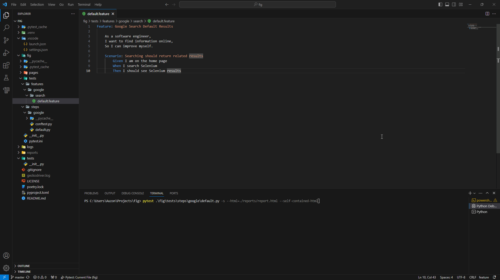

# Fig

Fig is an example repository to start your web tests using BDD approach.
It uses the combination of python, pytest, pytest-bdd, selenium and page object model at its core.
You can expand upon it and use it in your own projects.

## Examples on how to run

### Basic usage

```bash
pytest ./fig/tests/steps/google/default.py
```

### To generate HTML report

Add these parameters to the basic usage

```bash
--html=./reports/report.html --self-contained-html
```


